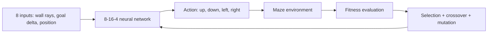

# Python AI Sandbox

[](https://www.python.org/)
[](https://github.com/SalehAkram/python-ai-sandbox/actions/workflows/tests.yml)
[](LICENSE)

A growing collection of interactive AI experiments built from first principles with Python, NumPy, and Pygame. Each project explores a learning technique in a visual environment while the reusable algorithms live in a shared library.

## Projects

| Project | Technique | Status |
|---|---|---|
| **Maze Runner** | Neural networks + neuroevolution | Complete and tested |
| Space Invaders | Reinforcement learning / neuroevolution | Planned |

## Maze Runner

A neural network learns to navigate a maze without backpropagation, labelled data, or a hand-written route. A genetic algorithm evaluates a population of agents, selects the strongest controllers, and creates new generations through crossover and Gaussian mutation.

**Reproducible result:** the default seeded experiment evolves an agent that follows the maze's optimal **11-step path**, typically within the first few generations. Seed `42` solved it at generation `7` in the reference run.

## Why this project matters

This compact project demonstrates AI fundamentals and production-minded Python engineering:

- A feed-forward multilayer perceptron implemented directly with NumPy
- Neuroevolution with elitism, fitness-weighted selection, uniform crossover, and mutation
- Ray-cast environmental sensing and normalized spatial features
- Dense fitness shaping based on shortest-path progress, exploration, efficiency, and collision penalties
- Deterministic experiments through seeded random-number generation
- Headless high-speed training separated from Pygame visualization
- Compressed model persistence and an automated regression test suite

## How it works



Each agent observes four wall distances, its relative goal position, and its current position. The network's four outputs represent movement actions. A breadth-first search distance map provides informative fitness feedback while never revealing the route to the controller itself.

The best networks survive unchanged (elitism). Other high-performing networks become parents; their weights and biases are recombined and mutated to form the next generation.

## Quick start

Requires Python 3.11 or newer.

```bash
python -m venv .venv
# Windows
.venv\Scripts\activate
# macOS/Linux: source .venv/bin/activate
pip install -r requirements.txt
python -m projects.maze_runner train --stop-when-solved
```

Training runs headlessly and saves the best controller to `artifacts/maze_runner/champion.npz`.

Replay it in Pygame:

```bash
python -m projects.maze_runner replay artifacts/maze_runner/champion.npz
```

Or train and immediately visualize the champion:

```bash
python -m projects.maze_runner train --generations 200 --population 150 --seed 42 --visualize
```

| Option | Default | Purpose |
|---|---:|---|
| `--generations` | 200 | Maximum evolutionary generations |
| `--population` | 150 | Neural controllers evaluated per generation |
| `--steps` | 80 | Movement budget per agent |
| `--seed` | 42 | Reproducible random seed |
| `--stop-when-solved` | off | Stop when any agent reaches the goal |
| `--output` | `artifacts/maze_runner/champion.npz` | Champion model path |

## Validation

```bash
python -m unittest discover -v
```

Tests cover sensor geometry, movement and collisions, network inference, mutation, model serialization, population stability, and deterministic training. GitHub Actions runs the suite on every push and pull request.

## Project structure

```text
projects/
  maze_runner/          Environment, agent, fitness, training, and CLI
shared/
  neural_networks/      Reusable neural-network implementation
  neuroevolution/       Reusable selection, crossover, and mutation
tests/                  Unit and reproducibility tests
```

## Design choices

**Why neuroevolution?** It makes optimization visible and intuitive while solving a sequential-control problem without gradients. Every network parameter is part of the genome.

**Why a distance map in fitness?** Sparse success-only rewards make early evolution needlessly slow. Shortest-path distance supplies a learning signal to the genetic algorithm, but the controller receives only its sensor inputs.

**Why separate training and rendering?** Headless evaluation is faster and easy to test in CI; Pygame remains an optional presentation layer for inspecting a trained policy.

## Future extensions

- Evaluate generalization across procedurally generated mazes
- Run population evaluation across CPU cores
- Add fitness-history plots and replay export to GIF
- Compare genetic optimization against reinforcement-learning baselines

## License

Released under the [MIT License](LICENSE).
