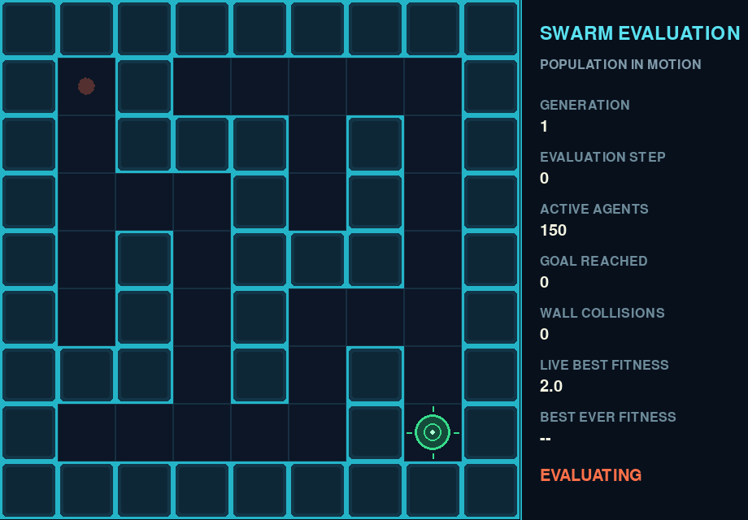
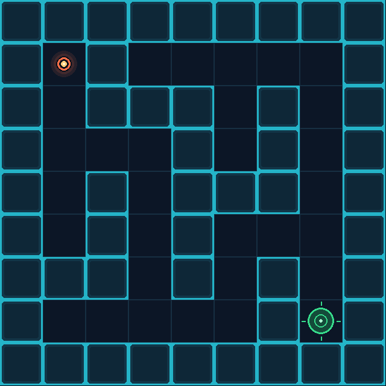
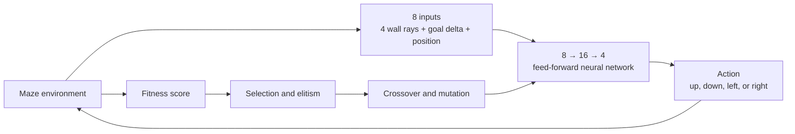

# Python AI Sandbox

[](https://www.python.org/)
[](https://github.com/SalehAkram/python-ai-sandbox/actions/workflows/tests.yml)
[](LICENSE)

A growing collection of interactive AI experiments built from first principles with Python, NumPy, and Pygame. Each project explores a learning technique in a visual environment, while reusable neural-network and evolutionary components live in a shared library.

## Maze Runner: neuroevolution in action



Maze Runner evolves a population of neural-network-controlled agents without backpropagation, labelled examples, or a hand-written route. Agents perceive the environment, choose movement actions, receive fitness scores, and pass successful parameters into the next generation through selection, crossover, and Gaussian mutation.

The deterministic reference experiment uses **150 agents per generation**. With seed `42`, it evolves an optimal **16-step solution at generation 94**.



## What this demonstrates

- A feed-forward multilayer perceptron implemented directly with NumPy
- Neuroevolution with elitism, fitness-weighted selection, uniform crossover, and Gaussian mutation
- Ray-cast wall sensing and normalized spatial inputs
- Fitness shaping based on progress, exploration, collisions, and repeated visits
- Deterministic experiments through seeded random-number generation
- Live Pygame population visualisation without affecting training results
- Model persistence, reproducible GIF export, automated tests, and CI

## How it works



Each agent receives eight normalized values:

1. Open distance in four directions
2. Horizontal and vertical displacement from the goal
3. Current horizontal and vertical position

The network produces four output scores. The highest score selects the next movement direction. A breadth-first-search distance map helps calculate fitness, but it is never given to the network as an input—the agent must act using only its sensors and position.

After every generation, the best networks survive unchanged. Other strong networks become parents, and their weights and biases are recombined and mutated to create the next population.

## Training signal

Fitness rewards:

- Best progress toward the goal
- Unique cells explored
- Reaching the goal
- Solving the maze efficiently

Fitness penalizes:

- Attempts to move through walls
- Repeated visits and unproductive loops

The live swarm view makes those behaviours visible: early agents collide, loop, and enter dead ends; later generations increasingly follow productive routes.

## Quick start

Requires Python 3.11 or newer.

```bash
python -m venv .venv

# Windows
.venv\Scripts\activate

# macOS/Linux
source .venv/bin/activate

pip install -r requirements.txt
```

Train headlessly and stop at the first successful generation:

```bash
python -m projects.maze_runner train --generations 300 --population 150 --steps 80 --seed 42 --stop-when-solved
```

Watch sampled generations as a live population:

```bash
python -m projects.maze_runner train --generations 300 --population 150 --steps 80 --seed 42 --stop-when-solved --show-training
```

Replay a saved champion:

```bash
python -m projects.maze_runner replay artifacts/maze_runner/champion.npz
```

Regenerate the portfolio GIFs from the seeded experiment:

```bash
python -m projects.maze_runner.export_gifs
```

### Training options

| Option | Default | Purpose |
|---|---:|---|
| `--generations` | 200 | Maximum evolutionary generations |
| `--population` | 150 | Neural controllers evaluated per generation |
| `--steps` | 80 | Movement budget per agent |
| `--seed` | 42 | Reproducible random seed |
| `--stop-when-solved` | off | Stop when any agent reaches the goal |
| `--show-training` | off | Display sampled population evaluations |
| `--training-interval` | 10 | Animate every Nth generation |
| `--training-fps` | 60 | Population animation frames per second |
| `--visualize` | off | Replay the champion after training |
| `--output` | `artifacts/maze_runner/champion.npz` | Saved champion path |

## Project structure

```text
projects/
  maze_runner/
    agent.py                 Sensors, movement, fitness, and rendering
    maze.py                  Environment, distance map, and maze rendering
    evolution.py             Evaluation and generation orchestration
    training_visualizer.py   Live swarm and training statistics
    export_gifs.py           Deterministic portfolio-media export
    __main__.py              Training and replay CLI
shared/
  neural_networks/           Reusable feed-forward neural network
  neuroevolution/            Selection, crossover, and mutation
tests/                       Unit and reproducibility tests
docs/assets/maze_runner/     README GIFs
```

## Validation

```bash
python -m unittest discover -s tests -v
```

The tests cover sensor geometry, movement and collisions, fitness behaviour, network inference, mutation, model serialization, population stability, and deterministic training. GitHub Actions runs the suite on every push and pull request.

## Design decisions

**Why neuroevolution?** It makes optimization visible and intuitive. Every weight and bias becomes part of the genome, so controllers can evolve without gradients.

**Why dense fitness feedback?** A success-only reward is too sparse for early generations. Progress and exploration create useful selection pressure before any agent completes the maze.

**Why separate training from rendering?** Headless training is faster and CI-friendly. Visual observation is optional, and regression checks confirm that enabling it does not change the deterministic result.

**Why sample generations?** Rendering all 80 steps of every generation would make the demonstration unnecessarily long. The live view and exported GIF sample milestones while preserving the authentic agent trajectories.

## Current limitations

The champion is optimized for one fixed maze and starting position. The feed-forward controller has no memory, and this project does not yet test generalization across unseen mazes. These are deliberate boundaries for the first experiment rather than claims of a general maze-solving system.

## Roadmap

- Add independently authored neuroevolution projects, beginning with Flappy Bird
- Evaluate controllers across procedurally generated environments
- Compare genetic optimization with reinforcement-learning baselines
- Explore recurrent networks for memory-dependent behaviour

## License

Released under the [MIT License](LICENSE).
